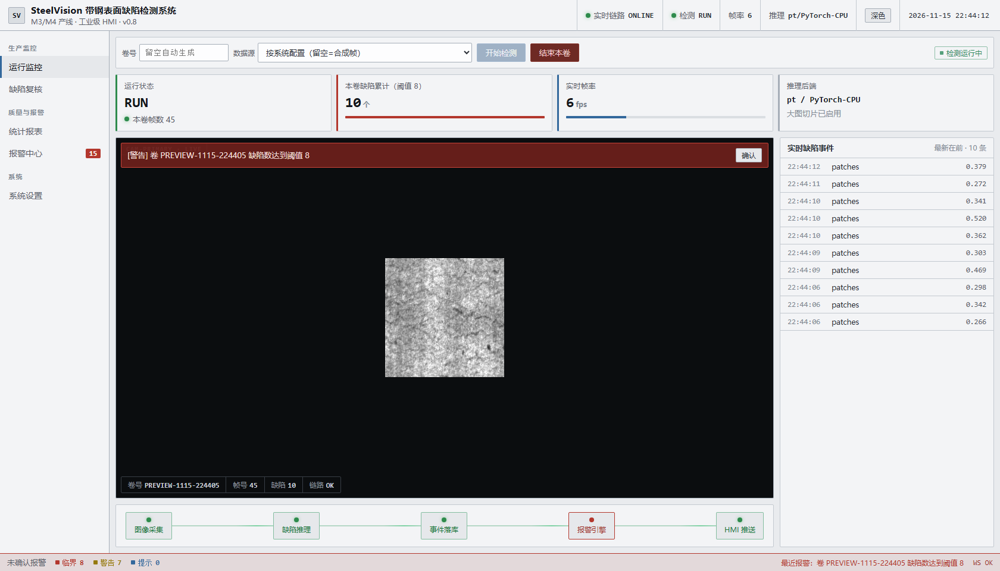
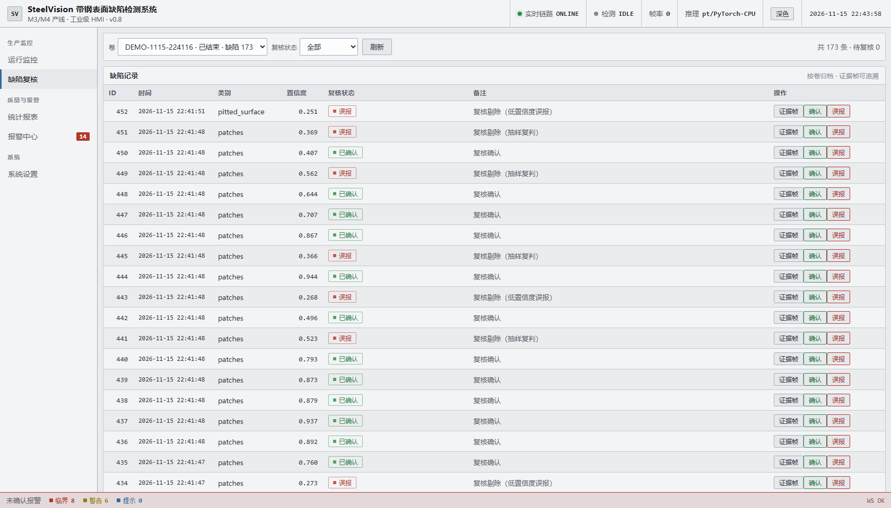
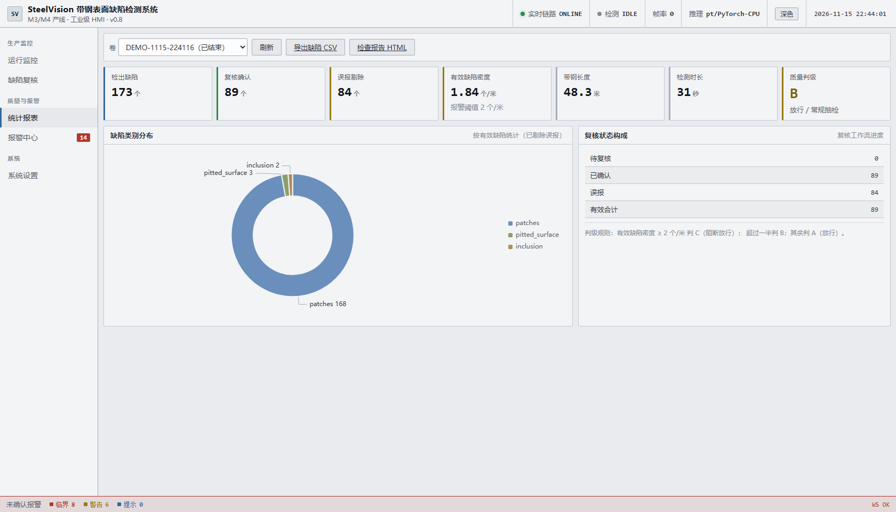
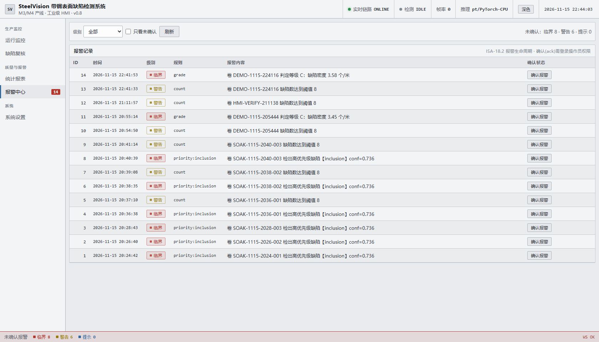
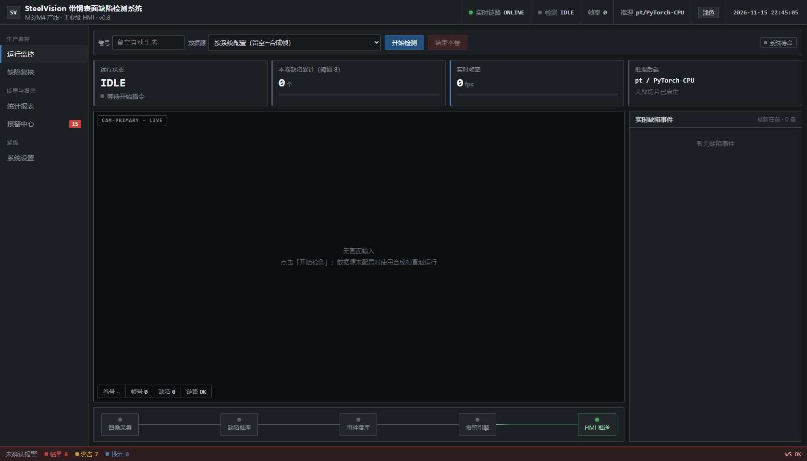

# SteelVision · 带钢表面缺陷检测系统

面向热轧带钢产线表面质量在线检测的软件原型系统。一套后端、一套 HMI，支持**浏览器**与**桌面 kiosk（PyQt5）**两种交付形态。

界面按 **ISA-101 高性能 HMI** 与 **ISA-18.2 报警管理**行业标准设计：中性灰底、颜色仅表异常、分级报警 + 确认工作流、检测框实时矢量叠加。

## 在线演示（无需安装）

**[https://enco1128.github.io/steel-vision/](https://enco1128.github.io/steel-vision/)**

基于真实运行系统导出的脱敏快照数据，在 GitHub Pages 上静态回放：五个页面均可操作
（复核标记误报会实时改变报表判级、报警可确认、设置可保存），实时画面循环回放真实检测帧。
刷新页面即恢复初始状态——演示环境不写入任何服务端。

> 线上演示为纯前端静态版（数据快照 + 内存态写操作）；完整功能请按下文「快速开始」本地运行。


## 功能总览

| 模块 | 说明 |
|---|---|
| 运行监控 | 实时画面 + 绿色检测框 SVG 矢量叠加（不烧录进视频流）、缺陷事件流、报警横幅、「采集→推理→落库→报警→推送」工艺链路可视化 |
| 缺陷复核 | 证据帧弹窗逐条复核：确认 / 标记误报 / 重置待复核，复核结果直接参与判级 |
| 按卷报表 | 缺陷密度 + 质量判级（A/B/C）+ 处置建议，类别分布饼图，CSV / HTML 双格式导出 |
| 报警中心 | ISA-18.2 分级（提示/警告/临界）+ 确认工作流，支持 PLC 外联动（Snap7 / Modbus TCP） |
| 系统设置 | 阈值、模型热切换、相机、联动、保留策略等运行时配置（admin 权限） |
| 双主题 | 浅色（ISA-101 经典控制室变体）/ 深色，偏好本地记忆，图表随主题重绘 |

## 界面

| 运行监控（实时检测） | 缺陷复核 |
|---|---|
|  |  |

| 按卷报表 | 报警中心 |
|---|---|
|  |  |

深色主题：



## 架构

```
┌──────────── HMI（Vue3 + ECharts，五页）────────────┐
│ 运行监控 / 缺陷复核 / 统计报表 / 报警中心 / 系统设置 │
└───────────────▲──────── REST + WebSocket ─────────┘
                │
        PyQt5 桌面壳（QWebEngineView kiosk）═══同一 HMI═══浏览器
                │
┌─────────────── FastAPI 后端 ───────────────────────┐
│ pipeline(采集→推理→事件→广播) → 报警引擎 → 外联动    │
│ detector(ORT CPU/CUDA/TensorRT-EP · .engine · 切片) │
│ camera(opencv/hikrobot/pypylon) · SQLite(WAL)       │
└─────────────────────────────────────────────────────┘
```

## 目录

```
steel-vision/
├── backend/
│   ├── app/
│   │   ├── main.py              # 应用入口、健康检查、SPA 托管、优雅停机
│   │   ├── api.py               # REST API（鉴权/卷/缺陷/复核/报警/报表/设置）
│   │   ├── models.py db.py      # SQLAlchemy 模型（SQLite WAL）
│   │   ├── core/config.py       # 全部可调参数（config.json 持久化 + 环境变量）
│   │   └── services/
│   │       ├── detector.py      # 多推理后端 + 大图切片 + NMS 融合
│   │       ├── source.py        # 帧源（相机/视频/目录/合成帧）
│   │       ├── pipeline.py      # 检测流水线（含报警联动）
│   │       ├── linkage.py       # PLC 联动（Snap7 / Modbus / dryrun）
│   │       └── alarms.py reports.py auth.py camera/
│   ├── tests/                   # pytest 套件（规则/判级/复核/鉴权/API）
│   └── scripts/                 # 守夜、演示、导出、验收工具
├── frontend/                    # Vue3 HMI（Vite dev: 5173）
├── desktop/                     # PyQt5 kiosk 桌面壳
└── docs/                        # 验收记录、相机接入、演示素材
```

## 快速开始

```powershell
# 后端（Python 3.12）
cd steel-vision\backend
pip install -r requirements.txt
python -m uvicorn app.main:app --host 127.0.0.1 --port 8000
# 浏览器打开 http://127.0.0.1:8000

# 前端开发模式（热更新）
cd steel-vision\frontend && npm install && npm run dev   # http://127.0.0.1:5173

# 桌面壳（自动拉起后端，F11 全屏）
cd steel-vision\desktop && pip install -r requirements-desktop.txt && python shell.py
```

默认账号：`admin/admin123`（管理员）· `operator/operator123`（操作员）· `viewer/viewer123`（只读）。
生产部署请务必修改默认密码并关闭演示数据。

无模型权重时系统使用**合成帧**冒烟运行（走完整检测-落库-报警-推送链路），便于无 GPU 环境体验全流程。

## 静态演示构建（GitHub Pages）

把本机运行中的系统导出为脱敏快照，构建为纯静态前端，推送到 `main` 后由 GitHub Actions
自动发布到 Pages（工作流见 `.github/workflows/pages.yml`）：

```powershell
# 1) 后端运行中，导出脱敏快照 → frontend/public/demo/snapshot.json
cd steel-vision\backend
python scripts/export_snapshot.py --frames 12 --source <NEU 测试集目录>

# 2) 演示模式构建（产物在 frontend/dist，可直接部署到任意静态托管）
cd steel-vision\frontend
$env:VITE_DEMO='1'; npm run build
```

演示构建特性：API 全部走本地快照、WebSocket 用录制帧循环回放、复核/报警/设置写操作仅在
内存生效（刷新恢复）、Hash 路由适配 Pages 子路径。快照导出时已做脱敏（模型/数据源路径、
临时自检卷全部剔除；证据帧仅含公开样本数据集 NEU 的标注图，不含任何现场采集数据）。

## 测试

```powershell
cd steel-vision\backend
python -m pytest tests -q          # 或 scripts\run_tests.cmd
```

覆盖：报警规则（优先级/计数阈值/去重）、质量判级边界、复核状态机与报表联动、鉴权权限矩阵、API 元信息。测试使用隔离临时数据库，不触碰本地数据。

## 推理后端矩阵（`auto` 自动降级）

| 环境 | model_path 指向 | 实际后端 |
|---|---|---|
| 无 GPU | `best.pt` | PyTorch CPU |
| 无 GPU | `best.onnx` | onnxruntime CPU |
| 有 NVIDIA GPU + onnxruntime-gpu | `best.onnx`，`infer_providers=tensorrt`，FP16 | TensorRT EP |
| 目标机器（GPU+TensorRT） | `best.engine`（部署机导出） | TensorRT engine |

导出：`python scripts/export_onnx.py --weights runs/.../best.pt`（GPU 机器加 `--half` 或 `--engine`）。

## 大图切片

`tiling: {enabled, tile_size:512|1024|2048, overlap, trigger_min_side}`。输入边长超过触发阈值时自动切块推理并合并 NMS；小图直接整图推理，无额外开销。

## PLC 报警联动

```json
"linkage": {"enabled": true, "driver": "snap7", "host": "192.168.2.1",
            "rack": 0, "slot": 1, "db": 1, "byte": 8080, "bit": 0, "pulse_ms": 500}
```

即 S7-200 SMART / S7-1200 的 `DB1.DBX8080.0`：报警置位 → 500ms 自动复位；断线自动重连；写失败仅记日志不影响检测。Modbus 用 `"driver": "modbus", "modbus_coil": 0`。设置页「测试联动」可点动验证（dryrun 无外部依赖）。

## 稳定性工程

| 能力 | 实现 |
|---|---|
| 日志治理 | RotatingFileHandler 10MB×5，统一落盘 `data/logs/app.log` |
| 健康检查 | `GET /api/health`：进程/数据库/磁盘/WS 连接数/流水线 last_error，异常返回 503 |
| WebSocket 背压 | 单客户端发送限时 2s，慢消费者断开，绝不阻塞检测线程 |
| WS 自愈 | 25s 心跳 + 1s→15s 指数退避重连 |
| 磁盘保留 | 证据帧/已确认报警默认保留 30 天，每 6h 自动清理 |
| 看门狗 | 巡检健康检查，连续 3 次失败自动重启后端 |
| 72h 守夜 | `python scripts/soak_test.py --hours 72 --coil-minutes 10` 采样内存/SQLite/API 输出 PASS/FAIL |

验收证据（守夜报告、复核闭环前后对比、绿框核验、桌面壳 F11 实测）见 [`docs/acceptance_record.md`](docs/acceptance_record.md)。

## 默认配置要点

| 项 | 默认值 | 含义 |
|---|---|---|
| `conf` / `iou` | 0.25 / 0.45 | 检测置信度 / NMS IoU 阈值 |
| `evidence_conf` | 0.5 | 证据帧留存的最低置信度 |
| `meters_per_frame` | 0.3 | 每帧对应带钢长度（影响密度报警） |
| `alarms.min_defects_per_coil` | 8 | 单卷缺陷计数报警阈值 |
| `alarms.density_per_m` | 2.0 | 缺陷密度报警阈值（个/米） |
| `retention.evidence_days` | 30 | 证据帧保留天数 |

可通过 `config.json`（自动生成于 `backend/`）或环境变量 `SV_MODEL` / `SV_SOURCE` / `SV_FPS` / `SV_CONF` 覆盖。

## 许可证

本项目代码仅作为科研项目成果原型。界面设计范式参考了 FUXA（MIT）、Frigate（MIT）、ThingsBoard（Apache-2.0）等开源工业软件的设计思路（设计迁移，非代码复制）；依赖库（FastAPI、Vue、ECharts、onnxruntime、python-snap7、pymodbus 等）遵循各自许可证。
